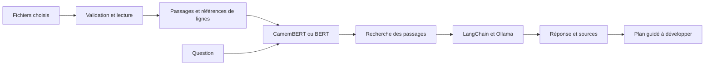

# Architecture proposée

Le socle sépare l'import, les encodeurs, l'accès Ollama et l'orchestration. Le code
fourni par l'utilisateur reste du texte : aucune importation Python, exécution,
installation de dépendances ou modification automatique de ce code n'est prévue.

Le premier graphe implémente seulement recherche puis réponse. Le plan guidé sera
un graphe distinct avec progression enregistrée et interruption avant de présenter
l'étape suivante. Les modèles ne recevront aucun outil permettant de modifier ou
d'exécuter les fichiers. Une confirmation humaine n'est pas une preuve d'exécution.

## Décisions initiales révisables

- Import : 50 fichiers au maximum, 200 000 octets par fichier, 2 000 000 par projet.
- Formats initiaux : `.py`, `.js`, `.ts`, `.tsx`, `.jsx`, `.html`, `.css`, `.md`, `.txt`.
- Aucune archive ZIP ou import Git distant dans le socle.
- Découpage de 30 lignes, références aux chemins fournis ; pas d'analyse syntaxique.
- Recherche en mémoire adaptée à un petit projet, sans base vectorielle pour le moment.
- Encodeurs interchangeables ; poids chargés à la demande et modèles non affinés.
- CLI pour valider la chaîne ; choix de l'interface française à la prochaine étape.
- Pas de persistance du code ou des conversations dans ce premier socle.

## Travail à terminer

Le prompt seul ne suffit pas à garantir les citations ni la résistance aux instructions
malveillantes dans le code importé. Ajouter une sortie structurée avec validation des
références et des essais adversariaux. Détecter les secrets évidents avant transmission.
Un filtrage de secrets ne garantit pas l'absence de toute donnée sensible.

Définir la conservation et la suppression des sessions avant d'ajouter le stockage.
Conserver une empreinte des fichiers : une nouvelle version doit invalider l'ancien
contexte et empêcher la poursuite d'un plan devenu obsolète.

La latence NLP à froid et le téléchargement des poids se mesurent séparément des
questions sur un index déjà construit. Les objectifs du CDC restent à vérifier.
